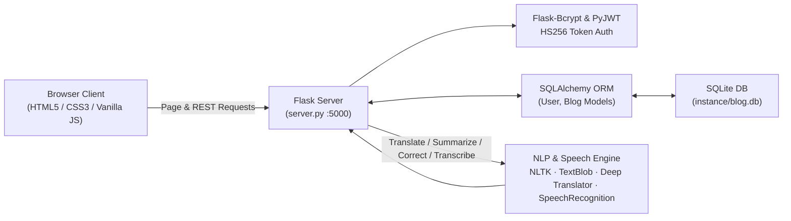

# 📊 iBlog (E-Blog System) — Detailed Project & Technical Report

**Project Name:** iBlog — Professional AI-Enhanced E-Blogging Platform  
**Primary Stack:** Python, Flask, Flask-SQLAlchemy, Flask-Bcrypt, PyJWT, NLTK, TextBlob, Deep Translator, SpeechRecognition  
**Database:** SQLite (`sqlite:///blog.db`)  

---

## 1. Executive Summary

**iBlog (E-Blog System)** is a full-stack web blogging platform built with **Flask** and **SQLAlchemy** that integrates practical **Natural Language Processing (NLP)** and **Speech-to-Text** capabilities directly into the content creation and reading workflow. Authors can write posts manually or via voice dictation, run automated spelling/grammar correction, translate posts across languages, and generate extractive summaries for readers.

---

## 2. System Architecture



---

## 3. Codebase & Template Inventory

| File | Description |
| :--- | :--- |
| `server.py` | 517-line Flask backend defining SQLAlchemy models, database initialization/seeding, HTML view routes, REST API endpoints, and NLP/audio processing utilities. |
| `requirements.txt` | Python dependencies (`Flask==2.3.3`, `Flask-SQLAlchemy==3.0.5`, `Flask-CORS==4.0.0`, `Flask-Bcrypt==1.0.1`, `PyJWT==2.8.0`, `nltk==3.8.1`, `deep-translator==1.11.4`, `textblob==0.17.1`, `transformers==4.35.2`, `SpeechRecognition==3.10.0`, `pyaudio==0.2.11`, `pocketsphinx==0.1.15`, `torch==2.1.0`, `numpy==1.24.3`, `requests==2.31.0`, `Werkzeug==2.3.7`, `Jinja2==3.1.2`). |
| `templates/index.html` | Landing page highlighting platform capabilities and navigation. |
| `templates/login.html` | Sign-in form posting credentials to `/api/login`. |
| `templates/signup.html` | Account creation form with client-side password strength meter posting to `/api/signup`. |
| `templates/blogpost.html` | Blog feed fetching `/api/get_blogs` with category filtering and previews. |
| `templates/blog_detail.html` | Individual article reader (`/api/get_blog/<id>`) with inline translation (`/api/translate`) and summarization (`/api/summarize`). |
| `templates/create_blog.html` | Rich blog authoring UI integrating `/api/add_blog`, `/api/correct_text`, `/api/translate`, and `/api/summarize`. |
| `templates/search.html` | Search interface querying `/api/search_blogs?q=`. |
| `PROJECT_INFO.txt` | Original project creation metadata and feature checklist. |

---

## 4. Database Schema (`SQLAlchemy` / SQLite)

Defined in `server.py` (`init_db()` automatically creates tables and seeds 5 sample articles on first launch):

### `User` Table
| Column | Type | Constraints | Purpose |
| :--- | :--- | :--- | :--- |
| `id` | `Integer` | Primary Key | Unique user identifier |
| `name` | `String(150)` | Not Null | User display name |
| `email` | `String(150)` | Unique, Not Null | Account email |
| `password` | `String(255)` | Not Null | Bcrypt password hash |
| `created_at` | `String(50)` | Default timestamp | Account creation timestamp |

### `Blog` Table
| Column | Type | Constraints | Purpose |
| :--- | :--- | :--- | :--- |
| `id` | `Integer` | Primary Key | Unique post identifier |
| `title` | `String(255)` | Not Null | Blog title |
| `content` | `Text` | Not Null | Full article body |
| `author` | `String(150)` | Default `"Anonymous"` | Author name |
| `date` | `String(50)` | Default timestamp | Publish date/time |
| `image` | `String(255)` | Default placeholder URL | Cover image URL |
| `category` | `String(100)` | Default `"General"` | Topic category (`Technology`, `Writing`, `Lifestyle`, `Health`, etc.) |
| `views` | `Integer` | Default `0` | Incremented on each `GET /api/get_blog/<id>` request |

---

## 5. NLP & Speech Processing Implementation

### 5.1 Extractive Summarization (`extractive_summarization`)
1. Strips non-alphabetic characters for frequency counting and tokenizes words/sentences via `nltk.tokenize` (`word_tokenize`, `sent_tokenize`).
2. Filters English stopwords (`nltk.corpus.stopwords`) and normalizes term frequencies against the maximum word frequency.
3. Scores sentences (`< 30` words) by average normalized keyword weight and selects the top `num_sentences=3` sentences via `heapq.nlargest`.

### 5.2 Auto-Correction (`auto_correct`)
- Uses `textblob.TextBlob(text).correct()` for full-text correction and evaluates individual tokens to return a `{original_word: suggested_word}` dictionary.

### 5.3 Translation (`/api/translate`)
- Wraps `deep_translator.GoogleTranslator(source='auto', target=target_lang).translate(text)`.

### 5.4 Voice-to-Text (`/voice-to-text`)
- Accepts multipart `audio` file uploads, converts non-`.wav` recordings (`.webm`, `.ogg`, etc.) using `pydub.AudioSegment`, applies ambient noise adjustment (`0.2s`), transcribes via `recognizer.recognize_google(audio)` with `recognize_sphinx` fallback, and deletes temporary audio files in a `finally` block.

---

## 6. HTTP Routes & API Reference

### Page Routes
- `GET /` → `index.html`
- `GET /login` → `login.html`
- `GET /signup` → `signup.html`
- `GET /create-blog` → `create_blog.html`
- `GET /blogs` → `blogpost.html`
- `GET /blog/<int:blog_id>` → `blog_detail.html`
- `GET /search` → `search.html`

> **Template Coverage Note:** `server.py` also defines route stubs for `/translate`, `/summarize`, `/voice-to-text` (`GET`), `/contact`, and `/recommend` pointing to standalone templates (`translate.html`, `summarize_blog.html`, `voice_to_text.html`, `contact.html`, `recommend.html`) that are not present in `templates/`. In the current build, translation, summarization, and auto-correction are integrated directly inside `create_blog.html` and `blog_detail.html` via the `/api/*` endpoints.

### REST API Routes
| Method | Endpoint | Request Body / Query | Response |
| :--- | :--- | :--- | :--- |
| `POST` | `/api/signup` | `{name, email, password}` | `200` confirmation or `400` validation error |
| `POST` | `/api/login` | `{email, password}` | `200` `{message, token, user}` (`HS256`, 24h expiry) |
| `POST` | `/api/add_blog` | `{title, content, author?, category?, image?}` | `200` `{message, id}` |
| `GET` | `/api/get_blogs` | — | JSON list of blogs (200-char content preview) |
| `GET` | `/api/get_blog/<id>` | — | Full blog JSON + increments `views` |
| `GET` | `/api/search_blogs` | `?q=<keyword>` | Matching blog list across title/content/category/author |
| `POST` | `/api/translate` | `{text, language}` | `{translated_text}` |
| `POST` | `/api/summarize` | `{text}` | `{summary}` |
| `POST` | `/api/correct_text` | `{text}` | `{corrected_text, suggestions}` |
| `POST` | `/voice-to-text` | `multipart/form-data` (`audio`) | `{text}` |

---

## 7. Security & Repository Hygiene Applied

1. **Removed Hardcoded Placeholder Secret:** Updated `server.py` to read `SECRET_KEY` from the environment (`os.environ.get('SECRET_KEY') or secrets.token_hex(16)`) and provided `.env.example`.
2. **Excluded Local Artifacts (`.gitignore`):** Ignored `instance/`, `*.db`, `temp_audio.wav`, `*.wav`, `__pycache__/`, `.env`, `venv/`, and `static/uploads/` so no local databases, temporary recordings, or credentials are pushed to GitHub.

---

## 8. Run Commands

```powershell
# Windows (PowerShell)
python -m venv venv
.\venv\Scripts\Activate.ps1
pip install -r requirements.txt
$env:SECRET_KEY="your_secret_key_here"
python server.py
```

Open **`http://127.0.0.1:5000/`** in your browser.
